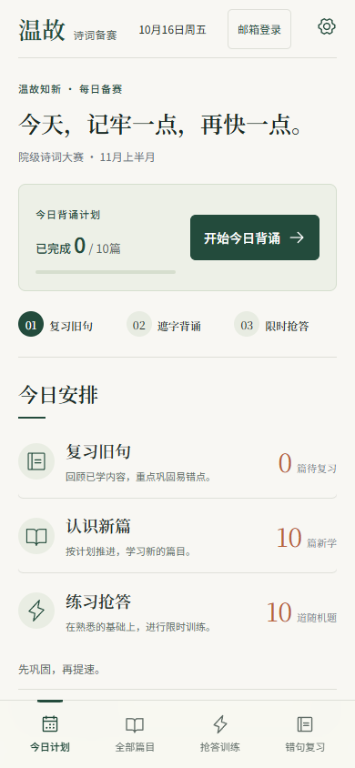
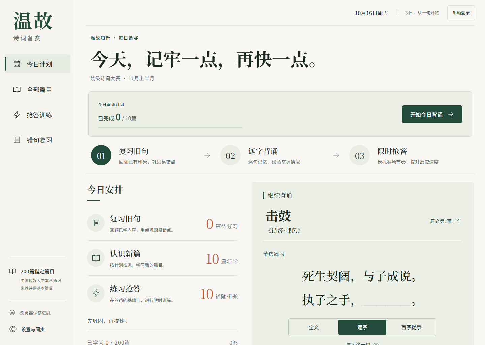
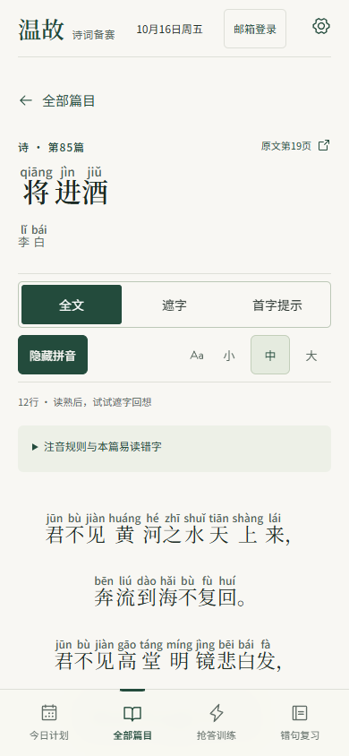
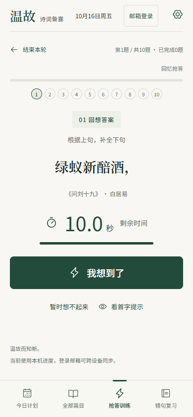

# UI 与 UX 优化验收 · 2026-10-16

依据用户“整体一起提升”的选择及明确调用的ui-ux-pro-max技能，在原有设计上改善学习流程。保留米白／松绿、自托管中文字体、桌面侧栏和手机底栏。

## 逐步检查与结果

| 步骤 | 原先阻碍 | 完成后的行为与验证 |
| --- | --- | --- |
| 1. 今日计划 | 手机开始入口约在632像素，学习进度接近底栏 | 首屏提供当日完成数、进度条和开始入口；访客0篇不虚构进度，实际自评一篇后由0/10变为1/10。正常。 |
| 2. 搜索与选篇 | 手机看不到命中诗句，返回目录会丢失搜索与加载位置 | 正文命中高亮、清空与组合筛选；空结果可恢复；从加载70篇后的第51篇返回，加载数量、焦点和滚动位置保持。正常。 |
| 3. 阅读与回想 | 长句可能只换下少数字，长篇控制栏会滚走 | 按分句成组换行，吸顶切换全文／遮字／首字、拼音与三档字号；字号刷新保留，揭晓与一键重新遮住均隐藏相应拼音。正常。 |
| 4. 设置一轮练习 | 手机开始按钮位于长设置表单之后 | 顶部显示本轮范围、题量、时间与作答方式；入口位于配置前，仍可向下调整选项。正常。 |
| 5. 限时作答 | 已完成数量、剩余时间和每题状态不够明确；按钮聚焦时空格停表受限 | 剩余秒数与时间条、逐题状态、真实完成进度；聚焦抢答按钮可按Space，输入空格不抢答；提示不算独立答对，超时只记一次。正常。 |
| 6. 反馈与复习 | 结束本轮直接返回设置，已答题缺少汇总衔接 | 提前结束汇总实际完成的题；三题中作答两题退出只记录两题；可去错句或再练一轮，反馈可回原文。正常。 |

## 界面对照

所有图片均来自当前审查的独立浏览器访客环境，未使用真实账号；截图逐一打开确认。最终手机截图采用390×844、触控设备模拟，桌面1440×1024；截图时减少动态效果，避免捕获过渡状态。

| 优化前手机首页 | 优化后手机首页 |
| --- | --- |
|  |  |

| 正文搜索 | 拼音阅读 | 限时抢答 |
| --- | --- | --- |
|  |  |  |

## 检查范围与边界

- 真实Playwright交互检查：首页学习进度、正文搜索／组合筛选／清空／空结果恢复、加载更多及返回位置／焦点、字号持久化、吸顶工具、拼音遮字／揭晓／重新隐藏、抢答Space、提示、自评、输入判分、提前结束、汇总、再练、错句、超时及减少动态效果。
- 在320、390、834、1440像素分别检查13个页面／篇目状态，包括首页、目录、设置、训练、错句，以及《将进酒》《七月》和现代诗等8篇长短不同的作品；大字号＋拼音时无页面水平溢出。
- axe检查WCAG2 A/AA、2.1 AA、2.2 AA：手机首页、搜索、大字号拼音阅读，桌面大字号拼音阅读与答题反馈，手机超时反馈，共6种状态均0项违规；额外检查手机触控后保持hover的已选拼音按钮，同样0项违规，深绿底浅字正常。
- 已修复实测发现的目录滚动位置在跳转归零后才被读取、题号状态缺少合法语义角色、触控选中拼音按钮hover覆盖深色背景三个问题。
- 29项原有数据／逻辑／数据库测试通过；4项模板发布测试通过；静态拼音复现校验与生产构建通过。原始题库、拼音数据、学习算法和同步协议无改动。
- 浏览器无未捕获页面异常。测试使用独立访客上下文，不操作用户真实账号或学习记录。本轮没有重新进行真实双设备登录测试，已有同步逻辑保持不变。自动扫描和截图不等于完整无障碍合规或真实手机硬件测试。

实施细节见[设计范围](superpowers/specs/2026-10-16-ui-ux-design.md)与[执行计划](superpowers/plans/2026-10-16-ui-ux-plan.md)。
